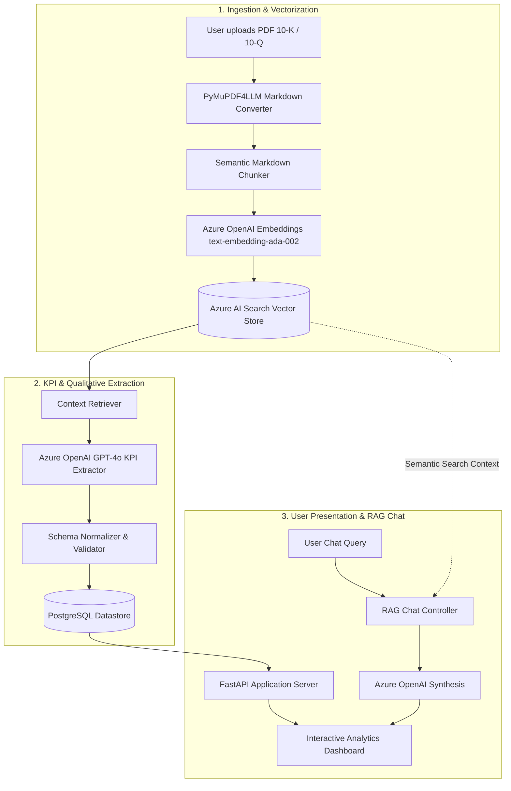

# InvestIntel AI — Financial Intelligence & RAG Platform

[](https://www.python.org/)
[](https://fastapi.tiangolo.com/)
[](https://azure.microsoft.com/)
[](https://azure.microsoft.com/products/ai-services/ai-search)
[](https://www.postgresql.org/)
[](https://www.docker.com/)

An enterprise-grade financial document intelligence platform that ingests annual and quarterly corporate filings (10-K / 10-Q PDFs), transforms unstructured filings into semantic vector embeddings, extracts audited financial KPIs into PostgreSQL, and delivers an interactive analytics dashboard with a conversational RAG AI Financial Analyst.

---

## Key Capabilities

* **Automated Document Ingestion:** Uses PyMuPDF4LLM to parse complex multi-page financial statements, tables, footnotes, and disclosures into clean structured Markdown.
* **Semantic Chunking & Vector Search:** Chunks financial prose with contextual continuity and indexes embeddings in **Azure AI Search** for low-latency hybrid retrieval.
* **Audited KPI Extraction:** Uses **Azure OpenAI (GPT-4o)** to systematically extract both quantitative metrics (Revenue, Net Income, Operating Income, Operating Cash Flow, Total Assets, Total Liabilities) and qualitative disclosures.
* **Qualitative Intelligence Synthesis:** Pinpoints **Top Growth Drivers** (catalysts, market expansion, product momentum) and **Top Risk Factors** (macro, operational, regulatory risks) across fiscal periods.
* **Conversational AI Analyst:** Grounded RAG chat drawer supporting cross-company queries, year-specific scoping, and instant analytical prompt chips.
* **Modern Fintech UI:** High-performance dark-mode terminal layout featuring glassmorphism, responsive comparative bar charts, and real-time engine telemetry.

---

## Application Architecture & Flow



### Detailed Pipeline Flow:
1. **Document Upload:** The user drops a company report PDF into the dashboard uploader (`/api/upload`).
2. **Document Normalization:** The file is converted from binary PDF to structured Markdown using `pymupdf4llm`, preserving financial tables and headers.
3. **Semantic Chunking:** Text is split using semantic boundaries to prevent breaking financial figures or statement tables across chunks.
4. **Vector Indexing:** Embeddings are generated via Azure OpenAI (`text-embedding-ada-002`) and pushed with metadata (company, year, source file) into **Azure AI Search**.
5. **Metric Extraction:** A specialized RAG prompt queries the vector store for core financial items and uses structured LLM output to extract audited values, growth drivers, and risk factors.
6. **Relational Persistence:** Metrics and narrative bullet points are stored in **PostgreSQL** under the `financial_metrics` table.
7. **Analytics Dashboard:** When the user loads `/`, FastAPI retrieves all persisted company metrics and renders comparative KPI cards, proportional benchmarking bars, and company deep-dive inspectors.
8. **AI Analyst Chat:** User questions are routed to `/api/chat`, where Azure AI Search retrieves the most relevant filing excerpts and GPT-4o answers with strict factual grounding.

---

## Technology Stack

| Domain | Technology | Purpose |
| :--- | :--- | :--- |
| **Backend Framework** | **FastAPI** (`0.115+`) | Asynchronous high-performance REST API and static UI serving |
| **ASGI Server** | **Uvicorn** (`0.35+`) | Production ASGI server with multi-worker support |
| **LLM & Synthesis** | **Azure OpenAI (GPT-4o)** | Financial reasoning, qualitative synthesis, and conversational Q&A |
| **Embeddings** | **Azure OpenAI** (`text-embedding-ada-002`) | High-dimensional semantic representation of financial chunks |
| **Vector Database** | **Azure AI Search** | Enterprise hybrid keyword + vector indexing and retrieval |
| **Relational Database** | **PostgreSQL** & **SQLAlchemy** | Structured storage of parsed financial KPIs, growth drivers, and risks |
| **PDF Processing** | **PyMuPDF4LLM** | High-fidelity table and layout preservation for financial PDFs |
| **Frontend UI** | **Jinja2 + Vanilla JS + Modern CSS** | Zero-bloat, glassmorphic dark-theme investor terminal interface |
| **Containerization** | **Docker** | Multi-stage container runtime respecting dynamic `$PORT` environments |
| **Dependency Manager** | **uv** / **pip** | Ultra-fast Python package management |

---

## Project Structure

```text
AI-investor/
├── .dockerignore                 # Excluded build artifacts for containerization
├── .env.example                  # Template configuration for environment variables
├── .gitignore                    # Python, virtualenv, and local file ignores
├── app.py                        # FastAPI application entrypoint & routing assembly
├── dockerfile                    # Production container image configuration
├── requirements.txt              # Pinned Python package dependencies
├── config/
│   └── settings.yaml             # Application configuration defaults
├── data/
│   ├── markdown/                 # Parsed markdown representations of filings
│   └── raw_pdfs/                 # Ingested PDF financial statements (Apple, MSFT, Tesla)
├── database/
│   ├── create_table.py           # PostgreSQL DDL table initialization
│   ├── metrics.py                # Database queries to fetch persisted financial records
│   ├── postgres_sql.py           # Engine creation and connection pool setup
│   └── save_metrics.py           # Insert/upsert logic for extracted KPIs
├── ingestion/
│   ├── ingest_documents.py       # End-to-end ingestion pipeline runner
│   ├── pdf_to_markdown.py        # PyMuPDF PDF-to-Markdown parser
│   └── semantic_chunker.py       # Markdown chunking with overlap preservation
├── llm/
│   └── azure_openai.py           # Azure OpenAI client factory
├── notes/
│   ├── Business Requirements.docx      # Product requirements and stakeholder specs
│   ├── Logical Arch & Notes.excalidraw # Visual logical diagram of system flow
│   ├── Physical-architecture.drawio    # Cloud deployment and infrastructure diagram
│   └── Presentation.pptx               # System architecture overview slides
├── rag/
│   ├── kpi_extractor_rag.py      # LLM-guided financial KPI extraction prompts
│   └── retrieval_debug.py        # Diagnostic script to test Azure Search retrievals
├── routes/
│   ├── chat.py                   # /api/chat RAG conversational endpoint
│   ├── dashboard.py              # Metrics inspection API routes
│   ├── health.py                 # /health service status probe
│   └── ingestion.py              # /api/upload multipart PDF ingestion endpoint
├── static/
│   └── style.css                 # Fintech terminal UI design tokens, animations & layout
├── templates/
│   └── dashboard.html            # Main Jinja2 dashboard with embedded analyst drawer
└── vectorstore/
    ├── azure_ai_search.py        # Vector store wrapper, indexer, and search retriever
    └── create_index.py           # Azure AI Search index schema generation script
```

---

## Getting Started

### 1. Prerequisites

* **Python 3.12 or 3.13** installed locally.
* **PostgreSQL** instance (Azure Database for PostgreSQL, local PostgreSQL, or Supabase).
* **Azure OpenAI** service with:
  * Chat model deployment (e.g., `gpt-4o`)
  * Embeddings model deployment (e.g., `text-embedding-ada-002`)
* **Azure AI Search** resource with an admin key.

---

### 2. Installation & Setup

1. **Clone the repository:**
   ```bash
   git clone https://github.com/your-username/AI-Powered-Investor-Intelligence-Platform.git
   cd AI-Powered-Investor-Intelligence-Platform
   ```

2. **Create and activate a virtual environment:**
   ```bash
   # Using UV (Recommended):
   uv venv
   .venv\Scripts\activate       # On Windows
   # source .venv/bin/activate  # On macOS/Linux

   # Or using standard python venv:
   python -m venv .venv
   .venv\Scripts\activate       # On Windows
   # source .venv/bin/activate  # On macOS/Linux
   ```

3. **Install dependencies:**
   ```bash
   # Using UV:
   uv pip install -r requirements.txt

   # Or using standard pip:
   pip install -r requirements.txt
   ```

4. **Configure environment variables:**
   Copy `.env.example` to `.env`:
   ```bash
   cp .env.example .env
   ```
   Fill in your service endpoints and credentials:
   ```env
   AZURE_OPENAI_ENDPOINT=https://<your-resource-name>.openai.azure.com/
   AZURE_OPENAI_CHAT_ENDPOINT=https://<your-resource-name>.openai.azure.com/
   AZURE_OPENAI_API_KEY=your_azure_openai_key
   AZURE_OPENAI_API_VERSION=2024-02-15-preview
   AZURE_OPENAI_API_EMBEDDING_VERSION=2023-05-15

   AZURE_OPENAI_EMBEDDING_DEPLOYMENT=text-embedding-ada-002
   AZURE_OPENAI_CHAT_DEPLOYMENT=gpt-4o

   AZURE_SEARCH_ENDPOINT=https://<your-search-name>.search.windows.net
   AZURE_SEARCH_API_KEY=your_azure_search_admin_key
   AZURE_SEARCH_INDEX_NAME=investor-intelligence-index

   POSTGRES_HOST=your-postgres-host.postgres.database.azure.com
   POSTGRES_PORT=5432
   POSTGRES_DATABASE=investor_intelligence
   POSTGRES_USER=your_username
   POSTGRES_PASSWORD=your_password
   ```

---

### 3. Run the Application

Start the local development server:
```bash
python app.py
```
Or run directly with Uvicorn:
```bash
uvicorn app.py:app --host 0.0.0.0 --port 8000 --reload
```

Open your browser and navigate to:
```text
http://localhost:8000
```

---

### 4. Running with Docker

Build and run the container locally:

```bash
# Build the Docker image
docker build -t investintel-app .

# Run container with your .env credentials passed
docker run --env-file .env -p 8000:8080 investintel-app
```
Access the application at `http://localhost:8000`.

---

## API Reference

| Method | Endpoint | Description |
| :--- | :--- | :--- |
| `GET` | `/` | Renders the primary Investor Intelligence dashboard |
| `GET` | `/health` | Health check endpoint returning `{"status": "healthy"}` |
| `GET` | `/api/metrics` | Returns all extracted corporate metrics as structured JSON |
| `POST` | `/api/upload` | Multipart file upload accepting `.pdf` reports for ingestion |
| `POST` | `/api/chat` | Accepts `{ "question": "...", "company": "...", "year": 2024 }` and returns RAG answer |

---

## System Design & Architecture Notes

Visual design documents and architectural reference slides are preserved in the [`notes/`](notes/) folder:
* **[Physical-architecture.drawio](notes/Physical-architecture.drawio)**: Detailed cloud topology and service interconnects.
* **[Logical Arch & Notes.excalidraw](notes/Logical%20Arch%20%26%20Notes.excalidraw)**: Step-by-step dataflow and sequence diagrams.
* **[Presentation.pptx](notes/Presentation.pptx)**: Project pitch, business rationale, and executive summary.
* **[Business Requirements.docx](notes/Business%20Requirements.docx)**: In-depth scope and functional KPI requirements.

---

## License

This project is licensed under the [MIT License](LICENSE).
